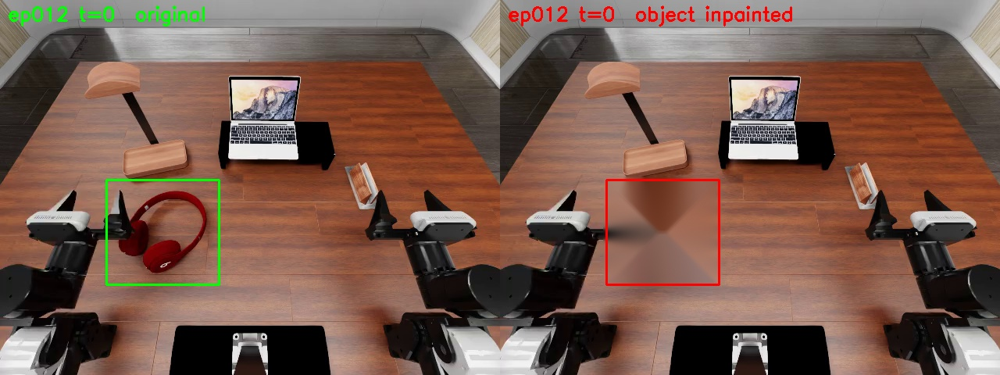

# E1 · 对象遮挡敏感度：判据到底看不看得见"物体"

回答一个问题：**把被操作物体从画面里彻底去掉，路线 A（现判据）与路线 C（冻结 VLA 中间表示）各会动多少？**

这是路线 C 的准入实验（决策 D17）：新表征若对"物体消失"依然不敏感，就不值得投实现。

## 1. 尺（无量纲，可跨表征比较）

```
sensitivity = median ‖ f(原帧) − f(去掉物体) ‖
              ───────────────────────────────
              median ‖ f(帧 i) − f(帧 j) ‖        （自然帧间差异）
```

≈0：该表征几乎不编码对象；≈1：去掉物体的影响与换一帧相当；>1：去掉物体比换一帧影响还大。

## 2. 数据与物体定位

| 项 | 内容 |
|---|---|
| 帧 | `data/eval25/videos` 头部相机，stride 5，25 集评测 |
| 物体 | 红色耳机 |
| 定位 | 严格红色阈值（hue ≤6 或 ≥174、S≥185、V≥50）→ 所有连通域**并集** bbox → 外扩 15% |
| 遮挡 | 对框做 `cv2.inpaint`（TELEA r=7），不是涂纯色（避免模型只学"有个方块"） |
| 覆盖 | 8 集 / **891 帧**（ep002/007/008/011/012/013/019/024）；其余 17 集该视角看不到耳机，跳过 |

一个必须修掉的细节：最初只用**最大**红色连通域，框只盖住耳罩、红色头梁还留在画面里（见 `assets/e1_occlusion_example_badly.png`），会把两边的敏感度都低估。改成"所有红色连通域并集 + 外扩 15%"后才真正盖住整只耳机。



图：左 = 原帧（绿框为物体框），右 = 去掉物体后的 inpaint 结果（ep012 t=0，耳机在桌面；t=217 挂在支架上时同样整只移除）。

## 3. 路线 A 的结果（6c，冻结 VAE，类 c1）

| 量 | 值 |
|---|---|
| `per_img` 原帧中位 | 0.6819 |
| `per_img` 去掉物体后中位 | 0.6850 |
| 变化中位（绝对值） | **0.0084** |
| 自然帧间差异（两两差的中位） | 0.0147 |
| **sensitivity** | **0.575** |
| 变差方向占比 | 60.5% |

读法：

- 去掉整只耳机，图像项只变化 **1.2%**（0.0084 / 0.68）。
- 相对自然帧间差异是 0.575，但**分母本来就很小**：891 帧来自同一任务的 8 集，场景高度相似，`per_img` 的帧间波动只有 0.0147。
- 换算到总分（≈2.48，图像项只占 0.68）后，这 0.008 的变化约 **0.3%**，对共形 p 值几乎无影响——与"25 集里 CAP 一次没触发"的观测一致。

## 4. 路线 C 的结果（ws，冻结 VLA 的 transformer hidden states）

表征取法与 `pi0.sample_actions` 里"先填 KV cache"的那次前向完全一致：

```python
toks, mask, ar = model.embed_prefix(obs)
attn = make_attn_mask(mask, ar)
pos  = jnp.cumsum(mask, 1) - 1
out, _ = model.PaliGemma.llm([toks, None], mask=attn, positions=pos)
hid = out[0][0, :256]        # 头部视角 256 个图像 token 的 hidden states（2048 维）
```

| 量 | 冒烟（16 帧） | **全量（891 帧）** |
|---|---|---|
| 头部视角 hidden states 形状 | 256 × 2048 | 256 × 2048 |
| `‖Δ‖` 中位（均值池化后 2048 维） | 2.87 | **2.42** |
| token 级 `‖Δ‖` 中位 | 19.6 | 16.5 |
| 自然帧间差异（300 帧两两） | 3.07 | **5.14** |
| **sensitivity** | 0.94 | **0.471** |
| 方向占比（遮挡后更远） | 100% | **100%** |

### 4.1 两个表征的对照

| 表征 | sensitivity | 方向一致性 | 绝对变化量 |
|---|---|---|---|
| 路线 A（VAE 图像项 `per_img`） | **0.575** | 60.5% | 0.0084 / 0.68（1.2%） |
| 路线 C（hidden states，2048 维） | **0.471** | **100%** | 2.42（相对自身尺度） |

**结论不能简单说"路线 C 更敏感"。** 全量下 C 的归一化敏感度（0.471）反而略低于 A（0.575），但差别只有 0.1，且有一个必须承认的方法学问题：

- 这个比值的分母是"自然帧间差异"，而两个表征编码的信息量完全不同。A 的 `per_img` 只是 3×4 池化图的重建误差（粗粒度外观），其帧间波动本来就小（0.0147）；C 的 2048 维 embedding 编码了姿态、光照、对象等全部因素，帧间波动大得多（5.14）。**同一个"物体消失"事件，在两个分母下换算出的比值不可直接比较。**
- 更有意义的是**方向一致性**：C 是 **100%**（去掉物体必然更远），A 只有 60.5%（接近抛硬币）。这说明 A 对对象变化既弱又不稳定，C 至少是一个**可靠的单向信号**。

要真正判定"谁更能看见对象"，需要一个尺度无关的配对检验（下一步）：

> 对每一帧比较 `d(原帧, 遮挡帧)` 与 `d(原帧, 最近邻的其它帧)`。若遮挡在该表征里"几乎没发生"，遮挡帧仍会被检索回它自己的原帧（比例接近 100%）；若表征看见了对象，比例会明显下降。这个比例与表征维度、噪声尺度都无关，可跨表征直接比。

路线 C 的 embedding 未落盘，做这一步需要重跑一次并保存（约 8 分钟）；路线 A 侧改用其 16 维潜变量做同一检验。

## 5. 局限

- 只遮挡头部视角，两个手腕视角未遮挡。
- 路线 A 侧为控制变量，把头部图复制到三视角槽位，且只比较图像项 `per_img`（状态项两次相同）。
- 遮挡是人工 inpaint，与"真的掉下去"仍有差别；保留的 inpaint 拖影本身也可能贡献一部分"变化"。
- 自然帧间差异的分母受取样集影响较大，跨表征比较时两边用的是同一批帧，但绝对数值不宜外推。
