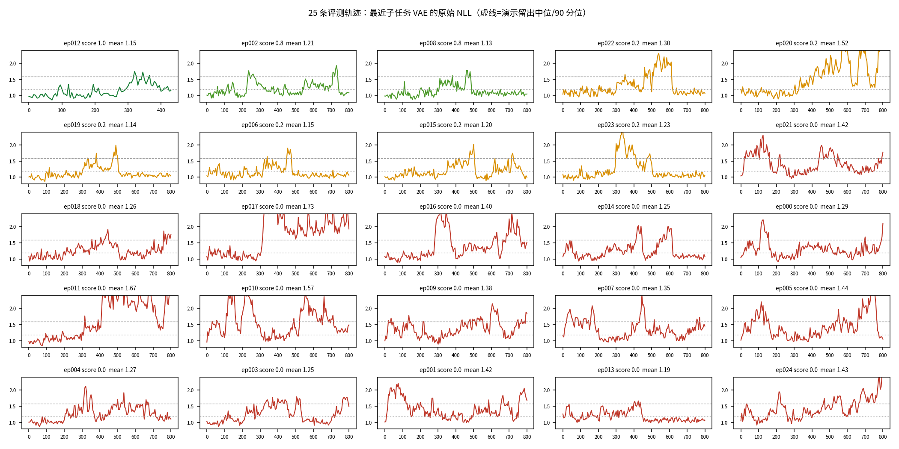
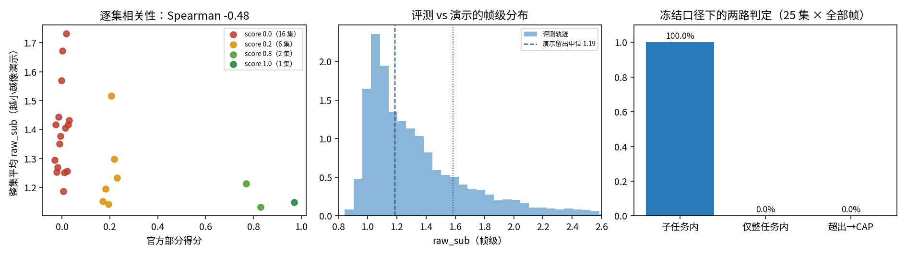

# 25 条真实评测轨迹上的两级 OOD 判定（EVAL25）

本文把冻结的路线 A 判据**真正跑在评测轨迹上**（不是演示留出集），回答两件事：

1. 一条真实 rollout 里，有多少帧"某个子任务分布能接住"、多少帧"只有整任务分布能接住"、多少帧"连整任务都在分布外"？
2. 这些判定是否与"这条 rollout 做得怎么样"对得上？

**一句话结论：冻结的两级门限在任务内是饱和的（100% 判为"子任务内"，0% CAP），它抓的是"跨任务"，抓不到"任务内做坏了"；但底层原始 NLL 仍有分级信息——逐集平均 NLL 与官方部分得分 Spearman −0.48，且用演示分布的 90 分位当阈值时，评测轨迹上有 19.6% 的帧越界（演示留出期望 10%），越界随进度累积（前/中/后 11.0% → 21.1% → 27.6%），成功集只有 4.6%。**

## 1. 数据

| 项 | 内容 |
|---|---|
| 策略 | T 臂（纯 VLA）：`Pi_05` ckpt 30000，`action_type=joint` |
| 任务 | Hang the headphones…close the laptop…place it into the vertical laptop stand |
| 布局 | 25 个（`layout_id` 0–24，`num_envs=1` 顺序跑） |
| 结果 | **成功 1 / 25（4%）**；官方部分得分：1.0×1、0.8×2、0.2×6、0.0×16 |
| 每集长度 | 失败集跑满 161 采样点（=805 帧 ≈32 s，stride 5）；成功集 87 点（≈17 s） |
| 视频 | 每集**三路**：`episode_XXXXXXX_cam_{head,left_wrist,right_wrist}_{success,fail}.mp4` |
| 关节状态 | 逐步落盘 19,634 行（`RD_DUMP_STATES`），按"归零姿态"切成 25 段，与 25 集一一对应 |

关节点：评测结果目录里**本来就有三路视频**（这一点之前被误记为"只有头部视频、手腕要靠插值补"），所以本次投影/打分不需要任何插补。

状态约定已核对：评测落盘的 `[L0..L5, gripL, R0..R5, gripR]` 与数据集 14 维 `left_joint_0..6 / right_joint_0..6` 逐维分位对齐（同量纲、同范围，唯一明显位移的是第 5 维——左腕俯仰，评测集中在负值，属行为差异而非约定差异）。**无需置换或符号翻转。**

## 2. 判定规则（与冻结路线 A 同源）

逐帧：

```
p_sub  = max_c  p_c          # 4 个已建模子任务 VAE 的共形 p 值取最大
p_task = p_task              # 整任务 VAE 的共形 p 值
决策   = "subtask"  if p_sub  >= 0.4145
         "task"     if p_task >= 0.01
         "cap"      otherwise
```

`τ_sub=0.4145, τ_task=0.01` 直接取自 `archive/route-A-vae3tile-state-k0/results/ood.json`，不重新标定。

### 2.1 一个必须先修的坑：校准口径

第一版我用"**每类自己的帧**前 70%"做共形校准（标准的类条件做法），结果演示留出集上只有 **56%** 的帧被判为"子任务内"，与路线 A 记录的 **99%** 对不上——但同一模型在留出集上的分类准确率是 0.90，与路线 A 的 0.894 一致。

差异来自路线 A 的校准实现：它的校准集是"**训练帧（所有类混在一起）的前 70%**"（`pilot_store_laptop.py: stage_ood` 里的 `cal_idx = idx_tr[:cut]`）。混合校准里混入了其它类的高分帧，把校准分布的上尾削平，于是所有帧的 p 值都被抬高——**冻结的 τ=0.4145 就是在这个被抬高的标尺上标出来的**。

所以本次严格复刻混合校准。修完后 ID 对照复现：

| 指标 | 路线 A `ood.json` | 本次复现（演示留出 25 集 / 2575 帧） |
|---|---|---|
| 子任务内接受率 | 0.9908 | **0.9856** |
| 仅整任务内 | 0.0010 | 0.0000 |
| 判 CAP | 0.0083 | 0.0144 |
| 分类准确率 | 0.894 | 0.850（仅 4 个已建模类 argmax） |

横向一致，可以认为管线可信；这也说明**冻结阈值只能在它的原生 p 标尺上解释**。

## 3. 主结果（冻结口径，25 集 × 全部帧）

| 判定 | 帧占比 |
|---|---|
| 子任务内 | **100.0%** |
| 仅整任务内 | 0.0% |
| 超出整任务 → CAP | **0.0%** |

也就是说：**25 条真实 rollout（24 条失败）里，没有一帧被判成"超出任务分布"，也没有一帧需要退到整任务 prompt**，哪怕其中十几条轨迹明确在做错事（官方部分得分 0.0）。

这不是"轨迹都在分布内"的证据，而是**门限在任务内饱和**的证据：混合校准把 p 值压在 0.7–0.9 的高位，τ=0.41 落在分布的低尾处，正常帧几乎不可能掉下去。路线 A 之所以能用它测出 AUROC 1.000，是因为**跨任务**（别的任务的帧）分数差得足够远，能压到 0 附近；**任务内**的变化幅度根本达不到这个量级。

## 4. 底层原始 NLL 还有多少信息

共形 p 饱和了，但原始 NLL（`nll_of` 的输出，越小越像）没有饱和。逐集平均 `raw_sub`（最近子任务）与官方部分得分：

| 得分 | 集数 | raw_sub 区间 |
|---|---|---|
| 1.0 | 1 | 1.15 |
| 0.8 | 2 | 1.13 / 1.21 |
| 0.2 | 6 | 1.14 – 1.52 |
| 0.0 | 16 | 1.18 – **1.73** |

- 逐集相关性：**Pearson −0.48、Spearman −0.48**（任务级 −0.43 / −0.36）。
- 用"首段（前 1/3）平均 NLL"比用整集更准：Spearman **−0.42**；用末段只有 −0.19。即**早段像不像演示，比晚段更能预测这条轨迹的结局**。
- 与演示留出的分布对比（同一套模型、同一标尺）：

| 分位 | 演示留出（2575 帧） | 评测轨迹（全部帧） |
|---|---|---|
| p10 | 0.975 | 1.008 |
| p50 | **1.186** | **1.231** |
| p90 | 1.584 | 1.854 |

中位几乎重合、上尾明显更重——这正是"大部分帧看起来和演示没区别，少数轨迹整段漂出去"的形状，也解释了为什么帧级阈值既抓不到又抓得准：**要抓的不是帧，是持续段**。

### 4.1 换成"演示分位数"当阈值

把阈值从"共形 p ≥ 0.4145"换成"原始 NLL > 演示留出的 90 分位（1.584）"：

| 集 | 官方得分 | 越界帧占比 |
|---|---|---|
| ep017 | 0.0 | **60.9%** |
| ep011 | 0.0 | 46.0% |
| ep010 | 0.0 | 40.4% |
| ep020 | 0.2 | 38.5% |
| ep021 | 0.0 | 30.4% |
| ep012 | **1.0** | 4.6% |
| ep008 | 0.8 | 2.5% |

全体越界帧占比 **19.6%**（演示留出期望 10%），且越界比例与官方得分 **Spearman −0.42 / Pearson −0.43**。这条曲线是可用的：前 3 名（60.9% / 46.0% / 40.4%）全是彻底失败且中途明显漂移的轨迹，成功集只有 4.6%。

### 4.2 出现在哪个阶段

按每条轨迹的归一化进度切三段，统计越过演示 90 分位的帧占比：

| 进度段 | 越界帧占比（阈值=演示 p90 1.584） | 阈值=演示 p75 1.383 | 帧数 |
|---|---|---|---|
| 前 1/3 | 11.0% | 19.3% | 1325 |
| 中 1/3 | 21.1% | 39.8% | 1325 |
| 后 1/3 | **27.6%** | 39.0% | 1301 |

**越界是累积的、晚段最严重**：前段基本贴着演示留出的期望值（10%），后段接近三倍。

这看起来与 §4 里"早段比晚段更能预测结局"矛盾，其实是两件事：

- **预测力**：早段"像不像演示"区分得开不同结局（ρ=−0.42），因为那反映的是**怎么接近任务**；晚段所有失败轨迹都收敛到"没能完成"的共同状态，分数彼此拉平（ρ=−0.19）。
- **脱轨量**：漂移本身随时间累积，所以越界帧在晚段最多。

工程含义：**判"是否脱轨"要看晚段和持续段；判"这条轨迹大概行不行"要尽早看前段。**

### 4.3 成功 vs 失败

| 组 | 集数 | >p90 越界帧占比 |
|---|---|---|
| 成功 | 1 | **4.6%** |
| 失败（全部） | 24 | **20.2%**（中位 17.4%，范围 2.5%–60.9%） |
| 　└ 官方得分 0.0 | 16 | 24.1% |
| 　└ 官方得分 0.2 | 6 | 14.9% |

只有 1 条成功轨迹，**不能做成功/失败统计检验**；但方向一致：成功集的越界率比失败集中位数低 3.8 倍，且失败集内部按部分得分单调分层（0.0 > 0.2 > 0.8/1.0）。



图：25 条轨迹的 `raw_sub` 随时间变化，按官方得分着色（灰虚线 = 演示留出中位 1.19，灰点线 = 90 分位 1.58）。ep11 / ep17 / ep20 在中段持续冲到 2.0–2.3，是"整段脱轨"而不是抖动。



图：左 = 逐集平均 NLL vs 官方得分（Spearman −0.48）；中 = 评测与演示的帧级分布（中位重合、上尾更重）；右 = 冻结口径判定占比（100% / 0% / 0%）。

## 5. 对路线设计的影响（重要）

1. **不要把"子任务门"和"整体脱轨门"混在同一个 p 值上，也不要让 VAE 去挑子任务。**
   - VAE 的职责只有两级拒识：**"有没有哪个子任务分布能接住"** 与 **"是否连整任务都在分布外"**。具体选哪个子任务、生成什么子任务 prompt 由 VLM 看图决定——本分析里出现的 argmax 类只用于**诊断**（看哪一类在接住帧），不参与路由。
   - 整体脱轨本质是**回归 + 阈值**：用原始 NLL 的分位数，而不是共形 p。
2. **冻结的 τ 只对"跨任务"有效**，不能拿来当"任务内做得对不对"的判据。要保留它作为"整任务范围外 → Astra 接管"的开关（路线 A 的 AUROC 1.000 支持这一点），但不应该在任务内期望它触发。
3. **持续性指标比帧级指标有用**：ep17 的 60.9%、ep11 的 46.0% 这种"整段越界"才是 CAP 应该接管的信号；单帧越界占 20%，噪声太大。建议落成"滑动窗口内越界比例 > 阈值 且 持续 ≥ N 秒"。
4. **两级路由的第二级（子任务都不准 → 整任务 prompt）在本任务上没有触发过**，因为子任务 VAE 总能接住某一类。若要让这条路径有实际意义，需要**校准子任务 VAE 的"接住"质量**（例如最大 p 与次大 p 的间隔、或类条件校准下的 p），而不是只看"有没有类能接住"。
5. 结合 [G35](G35_RESULT.md)：可分性差的任务上子任务级本来就不该启用。本次任务在 G35 里排第 5（平衡准确率 0.935，但只建模 3 个类），属于"相对可信"的那一档——即便这样，任务内门限依然饱和。

## 6. 局限

- n=25，且**成功只有 1 集**，所以"成功 vs 失败"只能靠官方部分得分做序回归；单任务、单 ckpt、单次运行，无方差估计。
- 校准集与 τ 都来自演示集；评测分布与演示分布存在策略差异（评测是 Pi_05 30k 自己的 rollout）。
- 帧级采样 stride=5（≈5 Hz），1 秒内的快速动作可能被跳过。
- 状态按"归零姿态"切集，若某次 reset 姿态非零会切错；本次 25 段与 25 集完全对应，可用。

## 7. 复现

```bash
# 1) 在 6c 上重训路线 A 的 VAE（100 集，与冻结路线 A 同超参）
python routeA_eval25_ood.py fit --episodes 100 \
    --emb caption_emb_bge_small.npz --out-prefix /tmp/eval25
# 2) 对照：演示留出集的接受率（应 ≈0.99 / 0.01）
python routeA_eval25_ood.py idcheck --episodes 100 --emb caption_emb_bge_small.npz \
    --models /tmp/eval25_routeA.pt --out-prefix /tmp/eval25
# 3) 评测轨迹打分
python routeA_eval25_ood.py score --models /tmp/eval25_routeA.pt \
    --eval-videos /tmp/eval25_videos --states /tmp/states_rd25.jsonl \
    --result-json /tmp/eval25_result.json --out-prefix /tmp/eval25
# 4) 出图（本机）
python3 scripts/plot_eval25_ood.py /tmp/eval25 --out docs/assets/eval25_ood
```

产物：

- `scripts/routeA_eval25_ood.py`（fit / idcheck / score 三段）
- `scripts/plot_eval25_ood.py`（出图）
- `docs/assets/eval25_ood_timeline.png`、`docs/assets/eval25_ood_summary.png`、`docs/assets/eval25_ood_metrics.json`
- 原始：`/tmp/eval25_routeA.pt`（模型 + 校准）、`/tmp/eval25_scores.json`（逐帧 p / 原始 NLL / 决策）、`/tmp/eval25_idcheck.json`、`/tmp/eval25_fit.json`；25 集三路视频与 19,634 行状态落盘
- 评测目录（ws）：`eval_result/RoboDojo/store_laptop_and_headphones/Pi_05/arx_x5/0_*rd25*/2026-11-24_22-29-16/`
