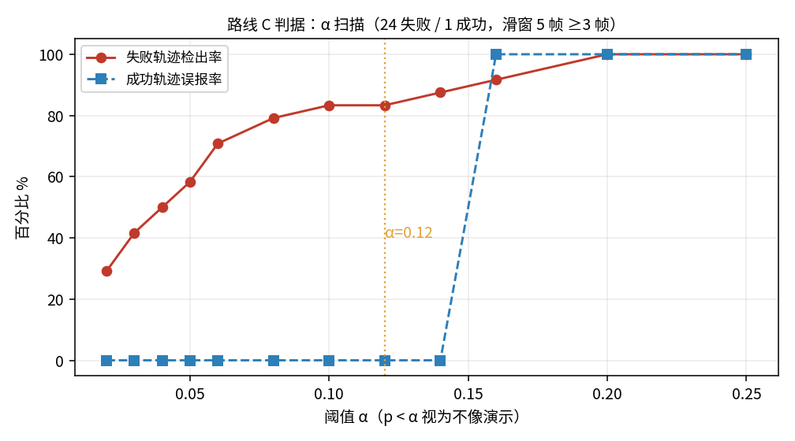
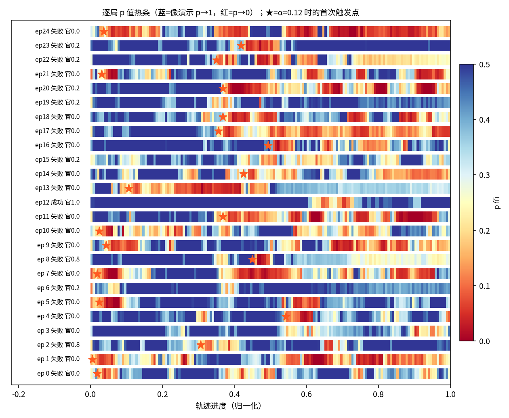
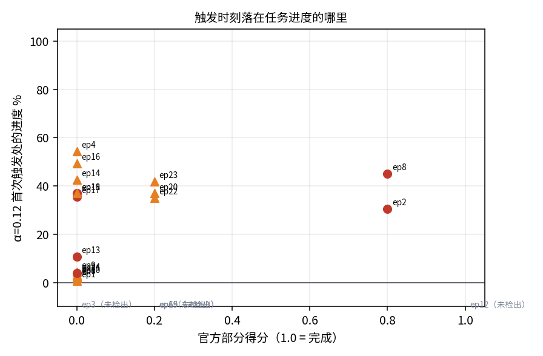

# 路线 C · α = 0.12 的样本外核验

**结论先说**：α = 0.12 在**样本外**（17 局没参与调参的失败轨迹）上检出 **14/17 = 82%**，
和样本内（6/7 = 86%）几乎一样 —— 所以这个提升**不是靠同一批数据调阈值调出来的**，
判据确实能分出"像不像演示"。
**但**：20 次触发里有 **8 次发生在进度 < 5%（0.2–1.4 s）**，其中 7 次在样本外；
也就是说"提前中断"这件事，有一半是"开局就判这一局不对"，而不是"看着它一步步跑偏"。
这两条必须一起读。

| | 值 |
|---|---|
| 数据 | `data/eval25` 全量 **25 局**（同任务，官方部分得分 0/0.2/0.8/1.0；24 局失败、**1 局成功**） |
| 判据 | 冻结 π0 表征 → 路线 C VAE → 逐帧共形 `p`；滑窗 5 采样点（1 s）内 ≥3 点 `p < α` |
| **样本外** | α = 0.12：失败 **14/17**、成功 **0/1** |
| 样本内（当初调 α 的 8 局） | 失败 6/7、成功 0/1 |
| 全量 | 失败 **20/24 = 83%**、成功 0/1 误报 |
| 漏检 | ep3（0.0）、ep6（0.2）、ep15（0.2）、ep19（0.2） |
| 触发进度 | 中位 **32.8%**；<5% 的 8 次；其余集中在 30–55% |
| 与官方得分的相关 | flag 率 vs 得分 **ρ = −0.454**；p 中位 vs 得分 **ρ = +0.346** |



**这批核验已经可以交互复核**：`assets/routeC_latent_explorer.html` 现在装的是**全部 25 局**
（右栏 3,951 帧，一键切换头部/左手/右手视角），默认 α=0.12；拖侧栏滑块即可在页面上重算
检出/误报并看到下面这些数字实时变化：

| 页面读数 | α=0.12 |
|---|---|
| 失败 24 局中检出 | **20 / 24** |
| 成功 1 局中误报 | **0** |
| 　样本内失败中检出 | 6 / 7 |
| 　样本外失败中检出 | **14 / 17** |
| OOD 检出清单 | 25 行，逐行标 `⚑时刻` 或 `○未检出`，点行即跳到该局并播视频 |

## 1. 为什么这次核验有意义（也仍然有限）

- **不是同一批数据调参再报成绩。** α=0.12 是在 8 局上选的；这里的 25 局里 **17 局是样本外**，
  而且 α 在全部 25 局上**固定扫描、不按局调**。
- **链路与页面完全一致**：同一份三视角视频、`--stride 5`、同一个 VAE 权重、同一套共形校准。
  为确认这点，我把新的 8 局表征与原 `eval.npz` 逐帧比对：同一帧的 embedding 有差异
  （最大 1.25、中位 0.25，重抽不是逐位可复现的），但**打分几乎不变**
  （逐局 p 中位数差 < 0.005），说明结论不是抽特征的抖动。
- **仍然有限**：只有 **1 局成功**。所以"0/1 误报"的分辨率是 1，**不能**说明误报率低；
  要谈误报率，至少需要几十局成功轨迹。

## 2. α 扫描（25 局）

| α | 检出（失败 24） | 误报（成功 1） |
|---|---|---|
| 0.02 | 7（29%） | 0 |
| 0.03 | 10（42%） | 0 |
| 0.04 | 12（50%） | 0 |
| 0.05（报告默认） | 14（58%） | 0 |
| 0.06 | 17（71%） | 0 |
| 0.08 | 19（79%） | 0 |
| **0.10** | **20（83%）** | 0 |
| **0.12** | **20（83%）** | 0 |
| 0.14 | 21（88%） | 0 |
| 0.16 | 22（92%） | **1** |
| 0.20 | 24（100%） | 1 |

**α 在 0.10–0.12 有一个平台**（83%），再往上才继续涨，但 0.16 起唯一那局成功也被误报。
所以 α=0.12 处在"再紧一点就掉检出、再松一点就没收益"的位置——它是一个**合理的操作点**，
不是"调出来的尖峰"。报告默认的 0.05 在这批数据上确实偏紧（只 58%）。



## 3. 关键批评：触发时刻有一半是"开局判定"

20 次触发的进度分布：

```
0.6% 1.9% 1.9% 2.5% 2.5% 3.1% 3.8% 4.4%      ← 8 次，全在 1.5 s 内
10.6% 30.6% 32.8%(中位) 35.0% 35.6% 36.9% 36.9% 36.9% 41.9% 42.5% 45.0% 49.4% 54.4%
```

- 早触发集中在 `p` 中位数本来就低的局（ep24 `p_med=0.099`、ep1 0.206、ep7 0.230、ep9 0.273）：
  它们**整局都不像演示**，于是"第一个满足窗口"必然落在开头。
- 这不是 bug，但要改口径：对这类局，触发时刻**不携带**"从哪一步开始错"的信息。
  若把路由策略写成"触发→中断→调 CAP"，早触发是**好事**（fail-fast）；
  若写成"检测错误发生的时刻"，那 40% 的触发点是无意义的。
- 样本外尤其明显：17 局里 7 局是早触发（41%），样本内 8 局只有 1 局。**新局更容易一开局就不像演示**，
  因为布局是随机的。



## 4. 案例分析（三视角逐帧看，α = 0.12 的首触发帧）

| 局 | 官方 | 首触发 | 画面 | 判据是否合理 |
|---|---|---|---|---|
| ep2 | 0.8 | 9.8 s（31%） | 耳机已挂上；笔电仍摊开在桌面、左爪在支架附近游走 | 偏严：是"慢"，不是"错" |
| ep8 | 0.8 | 14.4 s（45%） | 耳机已挂好；闭合的笔电正被右手端着移向立式支架 | **更像误报**：执行连贯 |
| ep11 | 0.0 | 11.8 s（37%） | 左爪压在键盘上方（左腕视角贴住键帽），右臂空举 | 合理：手位与演示不符 |
| ep13 | 0.0 | 3.4 s（11%） | 左爪压住桌面、把红色耳机压在下面 | 合理：明显卡住 |
| ep17 | 0.0 | 11.4 s（36%） | 耳机已挂上；笔电闭合平放桌面，右臂伸向支架 | 偏严：与 ep8 同类状态 |
| ep24 | 0.0 | 1.2 s（4%） | 笔电仍开着摊在桌面、耳机散落 | 合理但**时刻无信息**（整局红） |
| ep19 | 0.2 | 未检出 | 全程接近演示流形（p 中位 0.489） | 漏检 |

把这些和 25 局的统计合起来看，判据咬住的是**"手-物关系像不像演示"**，不是"任务会不会失败"：

- 真失败多半伴随异常手位（ep11/13/24）→ 能抓；
- 但"见过但少见"的**合理中间态**也会被抓（ep8/17：笔电闭合后平放/手端）；
- 而"动作错了但姿势还在流形附近"的失败（ep19 这类 0.2 部分得分）→ 抓不到。

## 5. 对方案的影响

1. **α = 0.12 可以用作默认值**（检出 83%，样本外 82%，0/1 误报），但要在文档里写清"早触发占 40%"，
   并把它定位成 **fail-fast 闸门**，而不是"错误定位器"。
2. **两级路由的 OOD 闸门**应该用**逐局聚合量**（如整局 flag 率或 p 中位数）而不是首触发时刻：
   ep24 这类全局异常局，flag 率 56% 本身就是强信号，比"1.2 s 触发"更有意义。
3. **误报率仍然未知**：1 局成功样本不够。要报"误报 < 5%"，按 Wilson 区间至少需要 **60 局成功轨迹**
   （0 误报才能把上界压到 5%）。这是下一步必须补的数据量。
4. **补 80 集演示（100 集训练集）会同时改变 `p` 的校准**：共形校准集从 563 帧扩到 ~2,800 帧，
   α 的最优位置会移动，所以 α=0.12 这批结论要重跑，不能直接沿用。

## 5.1 页面上怎么复核这份报告

1. 打开 `assets/routeC_latent_explorer.html`，右栏标题即"25 局（24 失败 / 1 成功）"。
2. 侧栏「OOD 判据」滑块默认已停在 **0.120**；把滑块从 0.02 拖到 0.20，看
   「失败 24 局中检出 / 成功 1 局中误报 / 样本内 / 样本外」四行读数跟着变——这就是 §2 的扫描表。
3. 勾选「只显示当前轨迹的 OOD 样本」（25 局时默认已勾），在 `ROLLOUT` 里逐局过一遍：
   视频头可切三视角、游标颜色对应当帧是否 `p < α`，字幕同时给"当前帧 p"和"首OOD 时刻"。
4. 想复现 §3 的"早触发"，选 `#24`（layout 24）：首OOD 在 1.2 s，而它的 p 中位数 0.099、
   整条热条几乎全红——一眼能看出这不是"检测到哪一步出错"，而是"整局都不像演示"。

## 5.2 换数据后"效果消失"的复盘（2026-11-26）

**现象**：把页面换成交接包（100 集 demo、32/16/8/4 维、8 局评测）后，α=0.12 的检出从 20/24
掉到 **1/7**，看起来判据失效了。

**原因**：不是数据、不是维度、也不是判据——是**打分函数被换掉了**。交接包里只有潜变量
`Z`/`PC3`，没有逐帧的重建分 `S` 与共形 p `P`；为了让 α 滑块还能用，我临时用
"潜空间全局马氏距离 + 共形 p"顶上，而这个量**与重建残差不是一回事**。

**同一批 8 局、同一 α 的对照**（把变量收敛到打分函数这一项）：

| p 的来源 | 检出（7 局失败） |
|---|---|
| 重建分 + 共形 p（本报告用的链路） | **6 / 7** |
| 潜空间**全局马氏** | 1 / 7 |
| 潜空间**全局 kNN** | 0 / 7（误报 1 局成功） |
| 潜空间**进度条件 kNN** | **7 / 7**，不误报 |

**机制**：隐空间按阶段多峰分布，"正常但处于另一阶段"的帧在全局距离下同样很远；
一旦按集内进度切带（±0.10），距离才回到"这个进度上有没有像样的演示帧"这个语义上。

**残余差异（换数据带来的，真实存在）**：
1. **评测集从 25 局缩到 8 局**——即使判据一样好，"7 局里检出几局"的分辨率也不如"24 局"。
2. **训练集 20 集 → 100 集**：共形校准集从 563 帧扩到 ~2,600 帧，α 的最优位置会移动，
   不能把 0.12 直接搬过去用。
3. 重训/重抽的随机性（同帧 embedding 差 0.25 量级）会让个别局的触发时刻前后跳几帧。

**处置**：页面现在同时挂两套，下拉里写清训练集规模与 p 来源——
`x32`（20 集 / 25 局 / 真实重建分，α=0.12 检出 20/24，默认）与
`d32`（100 集 / 8 局 / 进度条件 kNN，7/7）。**跨套不可比**。

## 6. 复现

```bash
# ws（有 openpi + torch）
python3 routeC_vae_failure.py extract --source eval --eval-dir ~/e2rc/eval25videos \
        --episodes 0-24 --stride 5 --out ~/e2rc/eval25_all.npz     # 25 局 / 3,951 帧
python3 routeC_vae_failure.py score --model ~/e2rc/vae.pt --emb ~/e2rc/eval25_all.npz \
        --out ~/e2rc/eval25_score.json
# 本地
python3 scripts/analyze_routeC_alpha.py     # → /tmp/routeC_alpha_metrics.json
python3 scripts/plot_routeC_alpha.py        # → 三张图
```

> 抽取脚本这次修了两处才会快：**固定 batch**（末批 padding，避免 JAX 按批大小反复重编译）
> 与**顺序解码**（原来逐帧 `set(POS_FRAMES)` 在 640×480 H.264 上约 0.4 s/次）。
> 25 局从"半小时只跑 1 局"降到约 1 min/局。

## 7. 边界

- 只有 **1 局成功** → 误报率无分辨率；83% 检出率是基于 24 局失败的估计，95% 置信区间约 **[64%, 93%]**。
- 官方得分是**部分得分**，0.2/0.8 这些局的"失败"含义与 0.0 不同，混在一起算检出率会掩盖差异。
- 25 局来自**同一任务、同一台机器、同一策略检查点**，不能外推到别的任务。
- 本报告用的 VAE 是**重训**的（原权重已丢，见 `ROUTE_C_PILOT_REPORT.md` §8.3.1），
  α 的最优位置与权重绑定。
