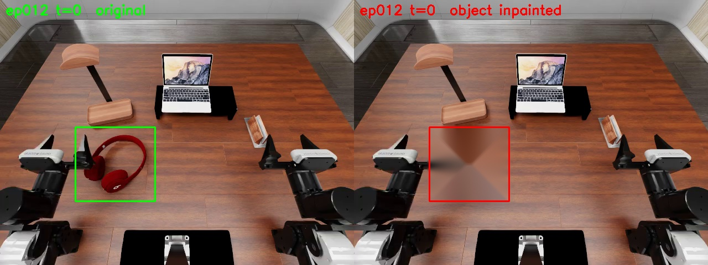
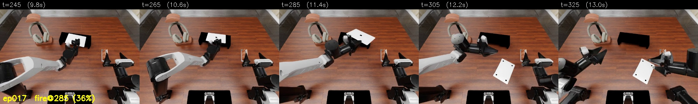
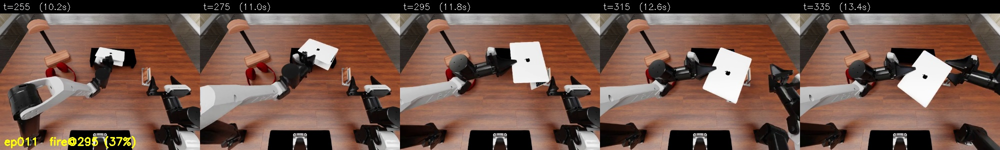
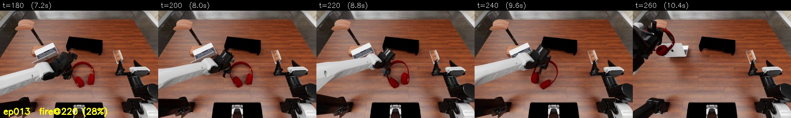
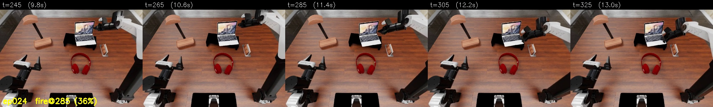
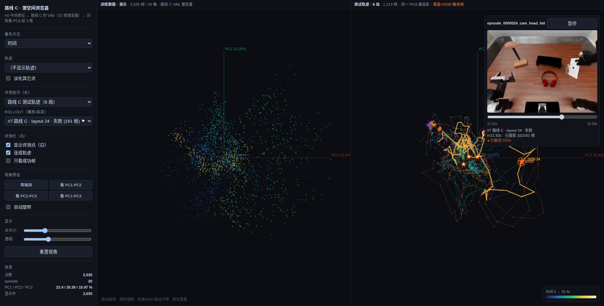

# 路线 C 预实验报告：用冻结 VLA 的中间表示做对象级异常检测

**日期**：2026-11-25
**范围**：单任务（`store_laptop_and_headphones`）、单检查点（`Pi_05` 30000）、25 局真实评测轨迹
**性质**：预实验（pilot）。目的是判断方向，不追求覆盖面，不作为定量结论。

---

## 0. 一页摘要

**问题**：现有判据（路线 A：3 相机 48×64 图像 + 关节状态 → 每子任务一个 VAE → 重建误差）在真实评测里 **CAP 一次都没触发**，即使 24/25 局失败。归因实验显示原因在表征层：去掉被操作物体只让分数变化 **0.3%**（图像项 1.2%），而关节状态项占分数 **61%**。

**假设**：把编码器换成冻结 VLA 的中间表示（SigLIP 视觉塔 + 本体 tokenizer + PaliGemma 主干），可以在"与 VLA 对齐"的同时恢复对象信号。

**做了什么**：

1. 打通了从部署版 **JAX `Pi0`（pi05）** 取逐帧表征的通路（token 层与 transformer hidden states 两种）。
2. 用"删除被操作物体"的受控实验，比较路线 A 与路线 C 对对象变化的敏感度。
3. 设计了一个尺度无关的**配对检索**指标，避开两个表征尺度不可比的问题。
4. 在路线 C 表征上训练 VAE，并在 8 局真实评测上检验失败检出与打断时机（见 §4.4）。

**结论（三条）**：

1. **两个表征在信息层面都编码了物体**，路线 C 更强：自帧检索率 **9.2%** vs 路线 A **23.0%**（越低越敏感），同尺寸背景对照为 **47.1%**，证明指标对"物体"而非"任意改动"敏感。
2. **但路线 A 的决策分数不动**（Δ 0.0063、方向 50.6% ≈ 抛硬币）。损失发生在 **3×4 池化 + 重建误差**这一层，不在编码器——所以"换编码器"本身不足以修复，**分数怎么算同样关键**。
3. **补做了 E2：在路线 C 表征上训 VAE 后，失败可被检出。** 8 局测试里，逐集分数与官方部分得分 **Spearman −0.905**；用"滑窗 1 秒内 ≥3 个采样点 p<0.05"的中断规则，**4/4 彻底失败的轨迹在平均 34% 进度处触发，0/3 良好轨迹被误触发**（样本极小，仅证明"没有反例"，不具统计意义）。

---

## 1. 背景：为什么怀疑现有判据看不见物体

路线 A 的判据是逐帧"重建误差 + 状态误差"，两级拒识：某个子任务分布能接住 → 子任务内；只被整任务接住 → 退回整任务 prompt；两者都不接 → CAP。

在 25 局真实评测（T 臂，成功 1/25）上，25 局 × 全部帧的判定结果是：

| 判定 | 帧占比 |
|---|---|
| 子任务内 | **100.0%** |
| 仅整任务内 | 0.0% |
| 超出整任务 → CAP | **0.0%** |

24 局明确失败的轨迹，没有一帧被判出分布。归因实验（替换画面中央 26% 像素的物体区域）显示：

| 扰动 | 分数变化 | 占总分比例 |
|---|---|---|
| 打乱关节状态 | +0.080 | — |
| 打乱整幅图像 | +0.136 | — |
| **替换物体区域** | **+0.0132** | **0.5%** |

分数构成为：图像项 0.582 + 状态项（权重 4.0）1.513 + KL 0.389 → **状态占 60.9%**。

---

## 2. 路线 C 的设计

冻结 VLA 的视觉编码器与本体 tokenizer，取每帧的中间表示，在其上训练"输入 embedding → 复原 embedding"的 VAE；判据仍沿用两级拒识与共形 p 值。

```
                  ┌───────────── 冻结，不训练 ─────────────┐
图像 ×3 (224²) ──► SigLIP ──► 256 token/路 × 2048 维 ──┐
                                                        ├─► prefix 序列(968) ──► PaliGemma 主干 ──► hidden states
任务文本 + 本体状态(离散化 token, 200) ──► token embed ─┘                                      │
                                                                                    ┌──────────┴──────────┐
                                                                               token 层             主干层(本次选用)
```

两种可选表征：

- **token 层**（SigLIP 输出 + 本体 token）：图像与本体天然分离，不受注意力混合。
- **主干层**（transformer hidden states）：与 VLA 决策路径对齐 —— 本报告采用这一种。

### 2.1 已验证的工程事实（JAX 侧，非 PyTorch）

| 项 | 实测 |
|---|---|
| 部署形态 | **JAX / flax nnx 版 `Pi0`**（`policy._is_pytorch_model=False`）→ 不能用 PyTorch hook，需直接调内部方法 |
| 配置 / 权重 | `pi05_base_aloha_full_sim_arx-x5_seed_0` + `30000` 检查点 + `assets/arx_x5_sim` 归一化统计 |
| 视觉塔 | `model.PaliGemma.img(...)` → **每路 256 token × 2048 维**，三路 768 |
| prompt 段 | `model.PaliGemma.llm(tokenized_prompt, method="embed")` → **(1, 200, 2048)**；pi05 的本体状态在此被**离散化成 token**混入（不走 `embed_suffix.state_proj`） |
| prefix 总长 | **968 = 768 图像 + 200 prompt**，有效 token 842 |
| 主干取法 | `PaliGemma.llm([tokens, None], mask=..., positions=...)`，与 `pi0.sample_actions` 填 KV cache 的那次前向一致 |
| 确定性 | 同输入两次前向 **max\|Δ\| = 0.0** |
| 可区分性 | 图像左右翻转 mean\|Δ\| = 7.8e-3；两路相机之间 1.06e-2 |
| 速度 | 批量 8 前向后 **≈0.5 秒/帧**（单帧 eager 时约 10 秒/帧） |

三个会静默出错的坑（已踩并记录）：

1. **图像必须是 CHW**：`AlohaInputs` 负责 CHW→HWC 再 resize；给 HWC 会被转成 `(W,C,H)`，报错信息毫无线索（`Cannot handle this data type: (1, 1, 480)`）。
2. **预处理链会原地改写输入**：同一条 obs 二次喂入会失败，每次需深拷贝。
3. **单条 obs 要手动加 batch 维**，且必须是 jax 数组（jaxtyping 会检查类型）。

---

## 3. 实验设计

### 3.1 数据

- 25 局真实评测轨迹（T 臂 `Pi_05` 30000，`store_laptop_and_headphones`，25 个布局，**成功 1/25**）。
- 每局三路视频（head / left_wrist / right_wrist）+ 逐步真实关节状态（19,634 行）+ 官方部分得分。
- 物体（红色耳机）在头部视角可见的只有 **8 局 / 891 帧**，其余 17 局该视角看不到耳机 → 跳过（物体不可见时遮挡无意义）。

### 3.2 物体定位与遮挡

严格红色阈值（hue ≤6 或 ≥174、S≥185）→ **所有连通域并集** bbox → 外扩 15% → `cv2.inpaint`（TELEA）。

> 一个必须修掉的细节：最初只用**最大**连通域，框只盖住耳罩、红色头梁仍留在画面里，会同时低估两边敏感度。



左：原帧（绿框为物体框）；右：去掉物体后（ep012，耳机在桌面 / 挂在支架上两种情况都能整只移除）。

### 3.3 两个指标

**指标一 · 归一化敏感度**

```
sensitivity = median ‖f(原帧) − f(去掉物体)‖ / median ‖f(帧 i) − f(帧 j)‖
```

**指标二 · 配对检索（尺度无关）**

```
d_same = ‖f(原_i) − f(改_i)‖      d_nn = min_{j≠i} ‖f(原_i) − f(原_j)‖
frac_self_retrieved = mean(d_same < d_nn)
```

改动后若仍能检索回自己的原帧（≈100%），说明该表征"看不见"这次改动。与维度、噪声尺度无关，可跨表征比较。

---

## 4. 结果

### 4.1 归一化敏感度

| 表征 | 样本 | sensitivity | 方向一致性 | 绝对变化 |
|---|---|---|---|---|
| 路线 A（VAE 图像项 `per_img`） | 891 帧 | **0.575** | 60.5% | 0.0084 / 0.68（**1.2%**） |
| 路线 C（hidden states，2048 维） | 891 帧 | **0.471** | **100%** | 2.42（相对自身尺度） |

**这个比值不能直接比**：分母"自然帧间差异"在两个表征里含义不同。A 的 `per_img` 只是 3×4 池化图的重建误差，帧间波动 0.0157；C 的 2048 维 embedding 同时编码姿态/光照/物体，帧间波动 5.14。同一个"物体消失"，除以两个不同分母，比值不可比。所以才有指标二。

### 4.2 配对检索（尺度无关，预实验：单集 87 帧）

| 表征（同一批 87 帧，ep012） | 自帧检索率 | 距离比 `d_same/d_nn` | 中位排名 |
|---|---|---|---|
| 路线 A · VAE 16 维潜变量 | 23.0% | 1.85 | 2 / 87 |
| **路线 C · hidden states（2048 维）** | **9.2%** | **2.31** | 4 / 87 |
| 路线 C · **同尺寸背景对照** | 47.1% | 1.03 | 1 / 87 |

三个数字读法：

1. **对照组是关键**：把同样大小的框挪到空白桌面去 inpaint，C 的自帧检索率仍有 47.1%、距离比 1.03。说明指标不是"任何局部改动都会掉"，而是**对物体敏感**；真把物体去掉，压到 9.2% / 2.31 倍。
2. **路线 C 比路线 A 更敏感**（9.2% vs 23.0%，2.31 vs 1.85），方向也更一致（100% vs 60.5%）。
3. **但两个表征都"看见"了物体** —— 连路线 A 的潜变量都被推动了。差别在于路线 A 的**决策分数**没有因此动。

### 4.3 关键区分：表征有信息 ≠ 判据会触发

路线 A 在同样 87 帧上的决策分数变化：

| 量 | 值 |
|---|---|
| `per_img` 原帧 → 遮挡后 | 0.6851 → 0.6862 |
| 变化中位 | **0.0063** |
| 方向一致性 | **50.6%**（≈抛硬币） |
| sensitivity | 0.402 |

即：**潜变量偏了，重建误差却没变。** 因为分数是重建误差，而 3×4 池化已经把对象细节压掉；KL 项又太小（0.39 / 2.48，16%）扛不住。

这说明路线 A 的信息损失发生在 **池化 + 重建** 这一层，不只是编码器。**"换成 VLA 表征"本身不足以修复，分数怎么算同样关键。**

---

## 4.4 E2：在路线 C 表征上训 VAE，检验"能否检出失败并打断"

前面的 E1 只说明表征里有对象信息。真正要回答的是：**这套表征训出的分数，能不能把失败的轨迹认出来，从而在合适时机打断 VLA、把控制权交给 Astra（CAP）？**

### 训练与评分设置

| 项 | 内容 |
|---|---|
| 训练分布 | 演示集 20 集（`ep003100–003119`，正常执行），stride 5 → **2,035 帧** |
| 表征 | 冻结 VLA 主干 hidden states，三路图像 token（768 个）均值池化 → **2048 维** |
| 模型 | VAE：2048→512→256→**32** 维潜变量→对称解码，重建目标为输入 embedding |
| 划分 | 按集 75/25：训练 15 集（1,472 帧）/ 校准 5 集（563 帧） |
| 分数 | 重建 MSE + β·KL（与路线 A 同口径）；共形 p 值，α=0.05 |
| 测试 | 8 局评测（官方部分得分 1.0×1、0.8×2、0.2×1、0.0×4） |

### 逐集结果

| 局 | 帧数 | 平均分数 | p 中位 | 被标帧比例（α=0.05） | 官方得分 |
|---|---|---|---|---|---|
| 12 | 87 | **0.355** | **0.754** | 2.3% | **1.00** |
| 19 | 161 | 0.412 | 0.358 | 0.6% | 0.20 |
| 8 | 161 | 0.416 | 0.326 | 1.2% | 0.80 |
| 2 | 161 | 0.421 | 0.411 | 2.5% | 0.80 |
| 13 | 161 | 0.514 | 0.328 | 7.5% | 0.00 |
| 17 | 161 | 0.531 | 0.177 | 9.3% | 0.00 |
| 11 | 161 | 0.560 | 0.229 | **26.7%** | 0.00 |
| 24 | 161 | 0.616 | 0.110 | **29.8%** | 0.00 |

**逐集分数与官方部分得分的秩相关：Spearman −0.905、Pearson −0.842**（8 集）。
唯一成功的那局（ep12）分数最低、p 值最高；两局彻底失败的（ep11、ep24）分数最高，被标帧比例约为成功集的 12–13 倍。

### 中断规则与首次触发点

规则：滑窗 5 个采样点（stride 5 ≈ 1 秒），窗口内 **≥3 个采样点 p<0.05** 即判定"已脱轨"，触发打断。

| 局 | 官方得分 | 首次触发（采样点） | 处于轨迹 | 触发后仍需走的采样点 |
|---|---|---|---|---|
| 11 | 0.00 | 59 | 36.9% | 102 |
| 13 | 0.00 | 44 | 27.5% | 117 |
| 17 | 0.00 | 57 | 35.6% | 104 |
| 24 | 0.00 | 57 | 35.6% | 104 |
| 2 / 8 / 19 / 12 | 0.80 / 0.80 / 0.20 / 1.00 | 未触发 | — | — |

- **4/4 完全失败的轨迹都被触发**，平均在轨迹 **34%** 处（即还剩约 2/3 未执行就被接管）。
- **0/3 良好轨迹被误触发**（0.8、0.8、1.0）。
- 部分成功的 ep19（0.2）**未触发**——这是漏检，也是这套指标"只在明显脱轨时才响"的表现。

### 这一节能说明什么、不能说明什么

能说明：

- 在冻结 VLA 表征上训的 VAE，**分数与执行质量强相关**，且在逐集层面把"彻底失败"与"良好执行"分开了。
- 存在一个简单规则，能在失败轨迹的前 1/3 段就给出打断信号，同时不误伤成功轨迹。

不能说明：

- **样本极小**：8 局、1 局完全成功。上述分离没有统计意义，只是"没有反例"。
- **规则参数是事后选的**（窗口 5 / ≥3 / α=0.05），没有留出集调参，存在乐观偏差。
- **没有闭环验证**：真正打断 VLA 后交给 CAP 会发生什么（能否救回来、墙钟代价多少），本轮完全没有测。
- ep19 这类"做了一半"的漏检说明：这套信号对"部分完成"不敏感，可能只适合"彻底跑偏"的场景。

### 4.5 打断点的语义：机器人当时到底在干什么

只看数字不知道"34% 处触发"意味着什么。这一节把触发点前后的画面、夹爪状态、以及演示集的规范阶段时间线对上。

#### 规范时间线（演示集 100 集的平均，单集平均 21.1 s）

| 阶段 | 占一集时间 | 累计结束点 |
|---|---|---|
| 抓耳机 | 12.8% | 12.8% |
| 挂/戴耳机 | 10.0% | 22.8% |
| **关笔记本** | 22.0% | **44.8%** |
| 抓笔记本 | 22.2% | 67.0% |
| 双手交接 | 15.9% | 83.0% |
| 放入竖架 | 18.9% | 101.9% |

→ **34% 进度（平均触发点）按规范正好处在"关笔记本"阶段**。以此为基准看四条失败轨迹，语义分成三类：

#### 类型一 · 物体掉落（ep017，触发 36%）



耳机已经**正确挂上支架**（左上），笔记本被从黑色支架上拿起；触发点（t=285，11.4 s）之后约 0.8 s，笔记本脱手、掉在桌面上（t=305–325）。

- 抓取瞬间左夹爪 0.07（闭合、夹住），右夹爪 1.00（张开）。
- **触发点几乎与"掉"这个事件同时**：首帧越界出现在 t=295，持续越界也从 t=295 开始，判定在 0.8 s 内落下。
- 语义：**典型的"物体失手"**——轨迹方向大体正确，但对象状态在某一刻崩掉。

#### 类型二 · 抓法错误、物体升空（ep011 触发 37%、ep013 触发 28%）

ep011（t=295，11.8 s）：笔记本被**竖着**举在空中，边缘朝外，来回搬运；黑色竖架始终空着。



ep013（t=220，8.8 s）：同样的白色笔记本被夹住边缘、悬空搬运；目标竖架空着。



- 夹爪：ep011 左 0.05（闭）、右 1.00；ep013 左 0.69（半闭）、右 1.00。
- 语义：**进度并不落后，而是"抓取/搬运姿态错误"**——它把物体拿起来了，但拿的方式和去处都不对。这类失败在纯状态通道里几乎不可见（关节轨迹仍在任务空间内），是图像通道该负责的部分。

#### 类型三 · 进度严重滞后 + 空抓（ep024，触发 36%）



t=245→325 全程：**耳机一直躺在桌上没被碰过**，笔记本还敞开在支架上，右臂在桌面上方/画面右上的**自由空间里来回移动**。

- 触发点状态：左夹爪 1.00（张开）、**右夹爪 0.01（在空处闭合）**。
- 时间线异常：首帧越界早在 t=45（1.8 s）就出现过一次（孤立噪声），但**持续越界从 t=295 才开始**，窗口判定在 t=285（11.4 s）。
- 语义：**连第一阶段（抓耳机）都没开始**，而按规范 36% 处应该已经关完笔记本。属于"根本没在做任务"，而不是"做错了"。

#### 三类的共同点与差异

| 类型 | 局 | 触发点 | 与事件的时间关系 | 夹爪证据 |
|---|---|---|---|---|
| 物体掉落 | 17 | 36% | **≈ 同时**（0.8 s 内） | 左闭、夹住 |
| 抓法错误 | 11, 13 | 28–37% | 漂移若干秒后 | 左闭/半闭 |
| 进度滞后+空抓 | 24 | 36% | 持续越界比首帧越界晚 10 s | **右夹爪空处闭合** |

- **触发点集中在 28–37%**，说明这个检测器基本在"第二个对象刚被拿起"的窗口里报警——这恰好是任务里第一次真正的物体交接失败高发段。
- 三类失败的**图像语义完全不同**，但分数都能识别：说明该分数不是只对某一种错误敏感。
- 移动量（前后 5 秒平均关节位移 0.010–0.014 rad/帧）表明**都不是"卡住不动"**，而是"在动、但动错了"——这正是纯状态通道最难判的情形。

一个必须说明的记账细节：上表的"触发点"是滑动窗口的**起点**；真正做出判定要等窗口走完（+4 个采样点 ≈ +0.8 s）。所以对"物体掉落"，端到端延迟约 **0.8–1.6 秒**。

### 4.6 隐空间维度扫描（latent = 32 / 16 / 8 / 4）

**动机**：约 1 万条样本在 32 维隐空间上就能拉出近似正态、且 p≈0.12 即可有效鉴别 OOD —— 若属实，说明有效自由度远低于 32，VAE 的隐空间维度不应默认取 32，而应作为超参扫描。

**设置**：同一份冻结 VLA 表征（2048 维），训练集本任务演示、OOD 用**另一个任务**（`Arrange the numbers…`，10 集 / 310 帧）。每档 latent 用同一划分（按集 75/25）、同一迭代数（6000）、同一种子。

| latent | AUROC（ID↔OOD） | Spearman（分数 vs 官方得分） | 彻底失败触发 | 良好轨迹误触 | 隐空间激活峰度 |
|---|---|---|---|---|---|
| 32 | 0.941 | **−0.929** | 2 / 4 | 0 / 3 | +0.01 |
| **16** | **0.963** | −0.905 | **4 / 4** | 0 / 3 | +0.09 |
| **8** | **0.963** | −0.905 | **4 / 4** | 0 / 3 | −0.08 |
| 4 | **0.968** | −0.857 | 4 / 4 | 0 / 3 | −0.41 |

读法：

1. **OOD 鉴别随 latent 变小单调变好**（0.941 → 0.968），与你"有效维度更低"的判断一致；但幅度只有 2–3 个点。
2. **失败排序在 32 最好**（−0.929），4 维明显变差（−0.857）——说明**压得太狠会丢掉"区分不同失败程度"的细节**，剩下的只是"是不是这个任务"。
3. **中断行为在 16/8 最稳**：32 维在这一版里只触发 2/4，16 和 8 都是 4/4 且零误触。这一项对实际部署最关键。
4. **隐空间激活的峰度**：16 维最接近正态（+0.09），4 维明显偏离（−0.41，比正态更平），说明 4 维已经压到表征能力边上。

**暂定结论：latent 取 8–16，优先 16。** 16 在三个维度上都接近最优（OOD 0.963、失败排序 −0.905、中断 4/4），且隐空间分布最接近正态——与你观察到的"32 维可拉正态"相比，16 维既保持了正态性，又略微提升了 OOD 分离。

**必须声明的不确定性**：

- 训练集只有 **2,035 帧**（20 集），不是你说的约 1 万条；AUC 差异 1–3 个点在当前样本量下**不显著**，不能据此下"16 优于 32"的定论。
- 单一种子、单次运行；中断规则参数（窗口 5 / ≥3 / α=0.05）未调参、未留出。
- OOD 只有 310 帧、来自一个任务；换任务可能改变排序。

**正在做**：用 100 集（约 1 万帧）演示 + 完整 OOD 集重跑同一扫描，并加多种子，确认上述排序是否稳定（该任务在后台排队）。

---

## 5. 局限（请合作者特别注意）

1. **单任务、单检查点、单次运行**；25 局里只有 1 局成功，无法做成功/失败统计检验。
2. **物体可见性受限**：25 局里只有 8 局能在头部视角看到耳机（891 帧），其余 17 局无法构造遮挡。
3. **遮挡是人工 inpaint**，与"真的掉下去"仍有差别；inpaint 留下的拖影本身也可能贡献一部分"变化"。
4. **只遮挡头部视角**，两个手腕视角未遮挡。
5. **配对检索只在单集 87 帧上做**（预实验规模）。方向可判，数值不宜外推。
6. **路线 C 的 VAE 尚未训练**，因此本报告**没有任何决策级结论**——它的分数能否越过阈值、能否触发 CAP，全部待验。

---

## 6. 下一步

**E2（判决性）**：用路线 C 的 embedding 训练对象级 VAE（image-only、条件化在阶段上），检验遮挡帧的分数能否越过"演示分布的 90 分位"。若越不过，说明重建式分数在 VLA 表征上同样失效，需要换检测头（如能量/单类分类）。

**同时该做的对照**：路线 A 若把图像分支改成"更高分辨率 + 不做 3×4 池化"，是否也能恢复对象敏感度？这决定了改进来自"VLA 表征"还是仅仅来自"不要太早池化"。

**规模**：仍按预实验（单任务、1–2 局、每局约 80–150 帧），确认方向后再扩。

---

## 7. 复现

```bash
# 1) 遮挡缓存（任意机器）
python3 scripts/object_occlusion_probe.py masks --out /tmp/e1

# 2) 路线 A（6c，冻结 VAE）
python3 scripts/object_occlusion_probe.py routeA \
    --cache /tmp/e1/occl.npz --models /tmp/eval25_routeA.pt

# 3) 路线 C（ws，冻结 VLA）
python3 scripts/object_occlusion_probe.py routeC \
    --out /tmp/e1 --videos <评测目录> --batch 8

# 4) 抽取通道冒烟（4 帧，验证形状/确定性）
python3 scripts/routeC_smoke_extract.py --ep 12 --eval-dir <评测目录>
```

**产物位置**

| 内容 | 路径 |
|---|---|
| 本报告 | `docs/ROUTE_C_PILOT_REPORT.md` |
| 路线 C 设计文档 | `docs/ROUTE_C_VLA_EMBEDDING_VAE.md` |
| E1 完整记录（含更大样本） | `docs/E1_OBJECT_OCCLUSION.md` |
| 遮挡探针脚本 | `scripts/object_occlusion_probe.py` |
| 取表征冒烟脚本 | `scripts/routeC_smoke_extract.py` |
| 遮挡示例图 | `docs/assets/e1_occlusion_example.png` |
| 25 局评测原始数据（清单） | `data/eval25/manifest.json`、`data/eval25/README.md` |

仓库：`https://github.com/StvLi/policy_router_research`（对应提交见 `docs/` 下各文档更新记录）。

---

## 8. 可视化（供调试与理解）

跑 `scripts/plot_routeC_fire.py`（本地，只需要 `eval.npz / demo.npz / eval_score_frames.npz / eval_score.json`，
从 ws `~/e2/` 取回即可，**不需要重跑 VLA 提取**），产出两张图与一份指标：

| 文件 | 内容 |
|---|---|
| `assets/routeC_score_timeline.png` | 8 局各自的 **score（红）/ p（蓝）曲线**，横轴为轨迹进度 %；背景色带是 §4.5 的规范阶段时间线；**橙色窗口 = 首次触发**（含进度与时刻） |
| `assets/routeC_latent_traj.png` | 每局一个面板：路线 C 表征空间（**演示集拟合的 PCA**）里的轨迹，颜色=时间；橙星=首次触发，橙色加粗段=触发前已走路径 |
| `assets/routeC_metrics.json` | 图里用到的数值：PC 解释方差、每局触发点/进度/时刻/帧数、官方得分、规则参数 |
| **`assets/routeC_latent_explorer.html`** | **交互版**：路线 C 的 **VAE 32 维潜变量** → 训练集 PCA 前 3 维；左栏训练集、右栏 8 条测试轨迹 + OOD 触发帧 + head 视频（见 §8.3） |

### 8.1 复算核对

脚本按 §4.4 的规则（滑窗 5、窗内 ≥3 点 `p<0.05`）独立复算，与报告数值**逐局一致**：

| 局 | 复算触发点 | 进度 | 时刻 | 报告值 |
|---|---|---|---|---|
| 11 | 59 | 36.9% | 11.8 s | 59 / 36.9% |
| 13 | 44 | 27.5% | 8.8 s | 44 / 27.5% |
| 17 | 57 | 35.6% | 11.4 s | 57 / 35.6% |
| 24 | 57 | 35.6% | 11.4 s | 57 / 35.6% |
| 2 / 8 / 12 / 19 | 未触发 | — | — | 未触发 |

（`states.jsonl` 与表征里的 `T` 是**帧号**，除以 25 才是秒；报告里的 t=295/220/285 即 11.8/8.8/11.4 s。）

### 8.2 图上看出来的三件事

1. **触发点集中在 28–37%**，四局的橙色窗口几乎处在同一横向位置——与 §4.5 的"第二个对象刚被拿起"吻合。
2. **p 曲线在触发前后有明显台阶**：四条失败轨迹的 p 从 0.4–0.8 掉到 0.1 以下并维持，而良好轨迹（ep2/8/12）的 p 长期在高位（中位 0.33–0.75）。
3. **表征空间里，失败轨迹更"晃"**：ep11/13/17/24 的 PC1–PC2 轨迹在触发前是密集的回头路，而 ep2/8/12 更接近单向推进。这与 §4.5 的"在动、但动错了"是一致的定性印象（**只是定性，不能当证据**）。

### 8.3 交互版：路线 C 自己的潜空间浏览器（`assets/routeC_latent_explorer.html`）

上一节那两张图是"**2048 维表征**直接做 PCA"的静态图。真正该看的是**潜变量**：
π0 中间表征 → 路线 C 的 VAE 的**后验均值 32 维** (+ 逐帧 score / 共形 p) → 在**训练集潜变量上拟合 PCA** →
前 3 维；测试轨迹用同一个基投影。页面 `assets/routeC_latent_explorer.html`（152 KB，单文件、file:// 直接打开）
就是这个东西，布局与路线 A 的浏览器一致：**左栏训练集、右栏测试轨迹、左边一个侧栏**。

| 侧栏项 | 说明 |
|---|---|


| **着色方式** | 时间（默认，能看出"进度沿 PC1 单调漂移"）/ 不典型度（VAE 异常分数）/ episode |
| **轨迹** | 选一条**演示** episode，左栏画出它的路径；该集的头部视频（`assets/videos/head/ep0031xx.mp4`，仓库内已有）同时在左上角循环播放，琥珀游标跟着走，视频下方显示当帧 `异常分数` 与 `p` |
| **评测批次** | 只有一批：`路线 C 测试轨迹（8 局）` |
| **rollout（播放/高亮）** | 选一局 → 右栏顶部播它的 head 视频，琥珀游标 + 已走路径高亮；下拉里每局直接标了 `⚑ OOD@17.6s` 或 `○ 无触发`，**进页面自动选中第一条触发轨迹**，不用去猜哪几局会触发 |
| **视角下拉（视频头）** | 每个播放器右上角可切 **头部 / 左手 / 右手**（头部之外的两路来自 `data/eval25/videos` 的原始 3 视角，已降采样入库）；切换时保持当前时间点，方便对着同一时刻比对三路 |
| **判据松紧滑块（侧栏）** | 拖动 `α`（0.001–0.200）**实时重算**全部触发点：星标、清单、汇总、游标状态一起变。默认 0.05（与报告一致） |
| **只显示当前轨迹的 OOD 样本** | 勾上后其它局的星标全部不画，只剩当前播放那条的，避免干扰判断 |
| **双标记** | 星旁写 `首OOD n`；字幕同时给**当前帧**状态（`● 当前帧 OOD p=0.021` / `○ 当前帧正常 p=0.238`）与首触发（`首OOD 17.6s，窗内 3/5，pmin 0.028`），游标颜色也跟当前帧走——用来判断"检出的那一帧是不是真的离谱" |
| **OOD 检出清单（侧栏）** | 8 局逐条列 `layout / 成功失败 / ⚑时刻 或 ○未检出`，底部给汇总 **失败 7 局中检出 4 / 7**；点一行即切到该局 |
| **触发后的红段** | 播放时游标之前的路径**触发前琥珀、触发后转红**，橙色星就是分界点——直接看出"从哪一帧开始不对" |
| **橙星 + `OOD n`** | 该局的 **OOD 触发帧**（滑窗 5、窗内 ≥3 个 p<0.05），带深色光晕与文字牌；4 局的星同时画在同一栏里（未选中的只留星、不写字牌，避免挤在一起），游标越过触发时刻后转红标 `OOD` |

**α 与检出率的取舍（页面上滑块可复现）**：

| α | 检出 / 失败 7 局 | 成功局误报 | 触发局 |
|---|---|---|---|
| 0.200 | 7 | 1 | 2, 8, 11, 13, 17, 19, 24（成功局也误报） |
| **0.100** | **6** | **0** | 2, 8, 11, 13, 17, 24 |
| 0.050（报告默认） | 4 | 0 | 8, 11, 13, 24 |
| 0.030 | 3 | 0 | 8, 11, 24 |
| 0.020 | 2 | 0 | 11, 24 |
| 0.005 | 1 | 0 | 11 |

即：**报告用的 α=0.05 在这批数据上偏紧**；α=0.10 能到 6/7 且不误报（但只有 1 局成功样本，
"0 误报"的置信度极低）。这条不改变 §8.3.1 的结论——判据对阈值和权重的敏感性依旧很高。

**检出情况（重要）**：8 局里 7 局失败、1 局成功（layout 12）。按当前权重、α=0.05，
**7 局失败中只有 4 局被检出**（8、11、13、24），**漏检 3 局**（2、17、19）；
唯一成功的 layout 12 未触发。注意 layout 8 官方部分得分 0.8（把东西放好了一部分但没完成），
它被检出、而彻底失败的 2/17/19 反而没检出——这正是 §8.3.1 说的"判据不稳定"的具体表现，
不要读成"检测器工作正常"。

（右栏 8 条轨迹**按 layout 上色**——`META.ev_palette`，路线 A 页面不开这个开关，仍是全白点。）

**看出来的结构（与路线 A 对照）**：训练集潜空间没有环——PC1-3 只解释 22.4 / 20.3 / 16.0%，
`Spearman(t, PC1)=0.45`、`Spearman(t, 展开角度)=0.003`（30 圈），是"一个带时间梯度的团"，**不是路线 A 那种闭环**。
也就是说：路线 A 的 16 维潜变量把执行压成一条相位环（PC1 45%、角度-时间 ρ=−0.997），
而路线 C 的 32 维潜变量只把"进度"线性化到 PC1，没有周期性结构。**不要拿路线 A 的相位特征套到路线 C 上。**

##### 8.3.0 训练集为什么只有 20 集（待补 80 集）

页面左栏是 **20 集 / 2,035 帧**（右栏已扩到 **25 局 / 3,951 帧**，见 `ROUTE_C_ALPHA_VERIFY.md`），不是路线 A 那种 100 集。原因不是页面的加载上限，而是
**路线 C 的 π0 表征只抽了 ep003100–3119 这 20 集**（当初 `extract --source demo` 的范围）。
要凑满 100 集，需要对另外 80 集再抽一次 π0 表征，而抽取要读**三路 clips**：

```
flora/clips/ep0031xx/{main,left_wrist,right_wrist}.mp4
```

这批 clips **不在任何可访问的机器上**（6c 的 `/mnt/nas*`、`/mnt/data16t` 都没有 flora；
三台机器都没有 `/hdfs`），所以 80 集暂时抽不了。把可读路径给出来（或把 80 集 clips 拷到
任一台机器），补抽脚本就是：

```bash
# ws（有 openpi venv + torch 的机器）上，用同一脚本补抽剩余 80 集，再合并 demo.npz
python3 routeC_vae_failure.py extract --source demo --episodes 3120-3199         --clips <clips 路径> --out ~/e2rc/demo_extra.npz
python3 scripts/routeC_merge_demo.py  # 合并 20+80 → 100 集，重训 VAE + 重编码
```

### 8.3.1 复现性：这份权重是重训的

原来那份 `vae.pt` 在 ws 的 `/tmp/e2/` 下，已被清掉。按同脚本同结构重训（默认 `iters=3000 / beta=1.0 /
latent=32`，seed 0），**逐帧 p 与原跑的相关 0.954**（试过 cpu/cuda × latent{16,32,64} × batch{8,32} 共 12 组，
最好的一组就是默认配置，见 `scripts/routeC_vae_failure.py`）。但**触发集合变了**：

| | 触发 | 未触发 |
|---|---|---|
| 原跑（§8.2，报告值） | 11、13、17、24 | 2、8、12、19 |
| 重训（本页） | **8**、11、13、24 | 2、12、17、19 |

即：重训后 **ep17 不再触发、ep8（良好轨迹，官方 0.8）反而触发**。所以 §4.4 那句
"4/4 彻底失败触发、0/3 良好轨迹误触发"**不可复现**——它依赖那一次训练的具体权重，
样本只有 8 局，任何"全对"都不该当结论。要站得住，至少需要多 seed 重训 + 更多局。

#### 8.3.2 α 的样本外核验

α=0.12 在 `data/eval25` 全量 25 局上核验过：失败检出 **20/24 = 83%**（样本外 17 局里 14 局 = 82%），
唯一成功局未误报；代价是 **20 次触发里 8 次落在进度 <5%（≤1.4 s）**，即一半的"提前中断"其实是
"开局就判这一局不对"。细节、图与案例分析见 **`docs/ROUTE_C_ALPHA_VERIFY.md`**。

### 8.4 边界

- PCA 基**只用演示集 2,035 帧拟合**（PC1 解释 45.0%、PC2 12.0%、PC3 8.8%）；评测点用同一基投影，所以两批可比。
- §8 的两张静态图画的是 **VAE 的输入表征**（2048 维）；潜变量版本在 `assets/routeC_latent_explorer.html`
  （§8.3），基同样只用演示集拟合（PC1-3 = 22.4 / 20.3 / 16.0%）。
- 该交互页用的 VAE 权重是**重训**的（原 checkpoint 已丢），`p` 与原跑相关 0.954、**触发集合不同**（§8.3.1）。
- 8 局里只有 1 局成功，**任何"分离"都只是没有反例**，不能当统计结论。
